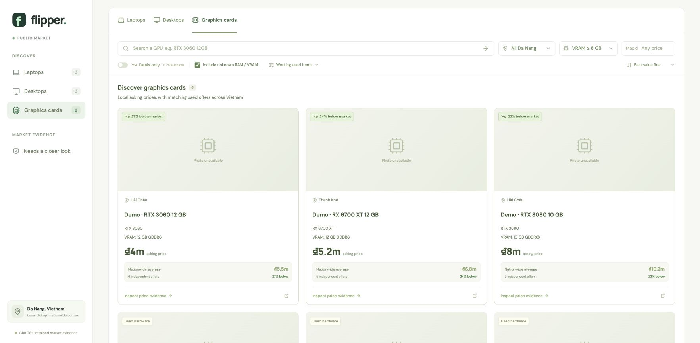

# Flipper

**Find used hardware with price evidence you can inspect.**

Flipper turns used laptops, desktops and graphics-card listings into a searchable
workspace for personal buying. It compares candidates in Da Nang with matching
nationwide Chợ Tốt asking prices, then shows the specifications, comparable
offers and uncertainty behind each reference. The application is
[MIT-licensed](LICENSE); phones are outside its current scope.

- [Open the live app](https://flipper.globesoul.com/)
- [Run locally](#run-locally)
- [Price methodology](#how-prices-are-compared)

The public app is a read-only market browser. Collection, optional AI calls,
saved items and settings belong to the private administrator workspace.



*The screenshot uses synthetic listings and illustrative prices in an isolated
local instance. It contains no marketplace seller data or photographs.*

## What it does

- **Shortlist relevant hardware.** Browse three categories and filter by model,
  memory, district, asking price and discount from a supported reference.
- **Explain a comparison.** Open the evidence drawer to inspect source claims,
  accepted and rejected offers, component adjustments and observed price history.
- **Keep uncertainty visible.** Missing memory capacity, contradictory
  specifications and insufficient or stale comparisons remain explicit.
- **Retain a useful workspace.** Keep saved searches, bookmarks and previous
  observations through refreshes. Optional daily scans have durable scheduling,
  request budgets and source-cooldown recovery.

These are comparisons of advertised asking prices, not completed-sale values,
physical-condition checks or resale-profit predictions.

## How it is built

The React and TypeScript UI connects to a Node.js API, with SQLite storing
listings, comparisons, history and job state. Marketplace collection,
hardware interpretation, pricing and scheduling have separate modules.

Optional LiteLLM calls classify listings and extract specifications supported by
seller text. Deterministic code filters comparable offers and calculates price
references and discounts; the app also works without a model key. The hosted
API separates anonymous market reads from private administrative actions.

The [fixture-based tests](test/) exercise parsing, hardware ambiguity, price
evidence, provider budgets, scheduler recovery and public/private API boundaries.
See [verification](docs/verification.md) for what those checks establish, and
[the API contract](docs/api-contract.md) for the client/server boundary.

## Run locally

Use Node.js 26 or newer:

```sh
npm ci
npm run build
npm start
```

Open **http://127.0.0.1:4317**. The loopback-only workspace serves the UI and API.
`npm run dev` starts Vite with hot reload and proxies `/api` to the backend.
State is stored in `.data/flipper.sqlite`. Copy `.env.example` to `.env` only
when configuring optional AI or hosted access. Credentials, runtime data,
backups and private deployment configuration are ignored by Git.

## Discover deals

1. Select Laptops, Desktops or Graphics cards, then use **Refresh market** or a
   model search. The current collection and its coverage stay visible.
2. Filter by RAM, VRAM, district, asking price and discount. Defaults are at
   least 16 GB RAM for computers and 8 GB VRAM for included discrete graphics
   or standalone cards, with unknown capacities included. Integrated-only and
   explicitly GPU-free computers are exempt from the VRAM minimum.
3. Inspect price evidence for the seller description, configuration checks,
   accepted/rejected comparables and price history. Analyze individual listings
   when a bounded category refresh has not yet compared their configuration.
4. Bookmark or dismiss listings and save searches in the personal workspace.
   Saved searches restore filters; saving one does not create a scan schedule.
5. Use **Settings & AI** for memory defaults, price thresholds, optional model
   access, and the separate daily-scan controls.

Seller-stated, manufacturer-inferred and possible memory types are labeled
separately. Inference never fills an unstated installed RAM/VRAM capacity.
Unknown specifications, contradictory seller claims and unavailable evidence
remain explicit.

## Daily scans

Automatic scanning is **disabled on new installations**. In the local/private
administrator workspace, open **Settings & AI** and enable **Daily market scans**.
The configured server must be running; no browser session is needed.

The schedule starts at **12:00 PM (noon), Asia/Ho_Chi_Minh (UTC+7)**. It runs full
laptop, desktop and graphics-card refreshes sequentially, using the same bounded
collection, detail checks, optional AI, specification cache and nationwide price
comparisons as manual refreshes. Persistent memory defaults and current scan
limits apply; display filters and saved searches do not create extra jobs.

Scheduled AI request budgets are **USD 0.25 per category and USD 0.75 per nominal
Vietnam schedule day**, separate from the editable manual-job budget. Each
attempt reserves its allowance durably before starting. External billing can
exceed an estimate; reported overages reduce later scheduled AI admission.
Unknown costs and interrupted attempts retain their reservation. Missing keys,
AI failures or budget exhaustion leave conservative parsing and fetched
comparisons available, with assessment status shown.

- First enable or resume waits for the strictly next noon.
- Existing manual work, provider tests and deployments defer collection.
- Each category receives at most one fresh scheduled allowance per Vietnam date.
- Source cooldowns persist across restarts. Marketplace requests wait until the
  deadline, and an eligible daily category is not claimed during that pause.
- A full refresh stopped by a source cooldown is queued for automatic recovery.
  Retry costs include prior attempts and unknown charges against the original
  allowance. A matching due daily category shares that job, avoiding duplicate
  scans. A repeated cooldown extends the wait without resetting the budget.
- Other failures, cancellations and interrupted categories are not automatically
  repeated. Other unstarted categories can continue when the source is available.
- Restarts recover the journal. Only the current day's missed work catches up;
  older days are skipped. A running category can finish across midnight;
  remaining categories are admitted only for the current eligible day.
- Pause stops further daily category starts and lets the active category finish.
  Queued source recoveries are independent and have their own **Cancel retry**
  control. The existing job-cancellation action can stop an active category.

Last/next-run status and category outcomes are private. No external alert
integration is configured. Operate one server process per data directory.

## How prices are compared

- The reference is the arithmetic mean of matching nationwide **used asking
  prices**, after filtering incompatible models/configurations, unsafe or
  ambiguous offers, the candidate and its seller, repeated sellers/ads, and
  numerical outliers. **Three or four other independent sellers** provide a
  clearly labeled indicative average and observed price range. Discount
  scoring and deal badges require **at least five** after filtering; that
  minimum can be increased. Indicative references have low confidence and no
  suggested maximum buy price.
- Numerical outliers use the lower and upper quartiles, expanded by 1.5 times
  the larger of the IQR or 10% of the median. This keeps equal-price cohorts from
  accepting an arbitrarily large outlier when their IQR is zero.
- GPU model variants, VRAM and materially different memory generations must match.
  Apple integrated graphics remain browsable with an unknown GPU core count,
  while price matching requires an explicitly stated variant and compatible
  MacBook family, screen size and exact chip. Known year or CPU-core differences
  also prevent matching. Compact `14inch`, `10CPU/16GPU`, `M2Pro` and styled
  seller text are supported; conflicting claims remain in review.
  A mobile or integrated GPU is never assigned a standalone desktop card's price.
- Computers first use sufficient complete-configuration evidence. Otherwise,
  **component-adjusted comparisons** normalize each comparable PC as
  `asking price − removed-part averages + added-part averages`, then average
  the resulting PC prices. Desktops retain the same CPU/platform and can adjust
  GPU, RAM and SSD. Laptops retain the same model, CPU and mobile GPU; RAM/SSD
  changes require source-verified replaceability. Parts needed for an adjustment
  must have explicit identities and supported independent price pools.
  RAM stick layout, speed, generation, form factor, ECC status and per-stick/bundle
  pricing must be verified when changing RAM. Unchanged RAM needs no invented
  stick layout. Known incompatible platforms and unpriced monitor bundles are excluded.
- Missing motherboard, power supply, case, cooling or other base details are
  displayed and lower confidence **without blocking scoring**. Each computer
  advertisement and seller contributes once; five GPU prices combined with one
  base PC are still one PC observation. The weakest computer/part pool determines
  whether the reference is indicative (3 or 4) or scoreable (at least 5, or your
  higher configured minimum). Explicitly linked seller accounts are deduplicated.
  The evidence drawer shows every source price, addition, deduction and missing detail.
- An ad's separately quoted with-GPU and without-GPU configurations retain their
  own prices. Unknown GPU inclusion is not treated as an explicit GPU-free PC.
  If a desktop still has no supported complete-PC reference, verified GPU, CPU,
  RAM or SSD values can form a labeled **partial component baseline**. Each part
  needs at least five matching independent offers; omitted parts remain unpriced.
- Default bargain gate: `(reference − asking) / reference ≥ 20%`, configurable.
- Seller descriptions must be retrieved before a price score is used. Missing
  or conflicting essential specs need review. References and local asking
  prices observed more than 24 hours ago do not produce current deal badges.
  Ads marked deleted, sold or otherwise unavailable cannot supply a reference
  or opportunity, even if their page still loads. An asking price below 10% of
  the supported reference needs a cash-price check in the review queue.

These are asking-price comparisons and editable estimates. The app has no
completed-sale dataset and does not verify a device's physical condition.

## Collection and persistence

Full market scans start at up to **200 recent local listings**. Coverage and source
totals are visible, and **Expand scan** allows up to 1,000. A refresh enriches up
to 30 promising/unresolved local listings and compares up to 12 distinct eligible
configurations. Those bounded detail, AI and comparison steps prioritize known
matches for all applicable memory minimums, followed by possible matches with
unknown capacities, then known failures; asking price orders each group.
The VRAM exemptions are the same as in the feed. Nationwide comparison pools
retain their configuration matching rules independently of these buying filters.
Focused national searches collect up to 60 offers per query by
default; this limit is editable. Computer detail reads prioritize the target's
RAM capacity, then unknown capacity, before differing capacities. Each computer
cohort can query up to 12 distinct required adjustment parts, followed by the
existing four possible partial-baseline component searches when necessary.
Pools are reused within the job. Remaining listings explicitly say they have not
been benchmarked and can be analyzed individually. Additional description checks
are made for candidates that are about to be priced.

Requests are paced. Nationwide raw pools can be reused for six hours; AI
assessments are cached by listing content and asking price. Source failures retain
previous observed results and show the failed refresh. Price changes, favorites,
dismissals, searches and settings persist in `.data/flipper.sqlite`.

The source adapter reads public embedded listing data. Source access can change;
failed collection remains visible alongside retained observations. Source and
dataset boundaries are described in [data sources](docs/data-sources.md).

## Optional AI through LiteLLM

Flipper works without a model key using conservative local interpretation.
For AI, set `LITELLM_API_KEY` privately in `.env`, or save a gateway key in
Settings. An environment key takes precedence. Saved keys use a mode-0600
`.data/secrets.json` and are never returned by the API.

Hardware extraction uses `xiaomi_mimo/mimo-v2.6-flash` through Chat Completions;
classification uses `perplexity/pplx-decider-v1.2` through the separate
OpenRouter Decisions passthrough. Configure gateway URLs in `.env.example`.
AI extracts source-supported claims; deterministic code calculates prices and
discounts. Route availability and model quality need their own verification.
See [LLM settings](docs/llm-settings.md).

## Specification data and licensing

Optional public [TechAPI](https://github.com/GetTechAPI/TechAPI) CPU/GPU and
laptop specifications supplement reviewed manufacturer rules. Feed/detail
reads use local caches only. Collection can warm bounded batches with a 30-day
cache lifetime and last-good offline fallback. `npm run memory:sync` updates
caches for retained listings; restart the server after an external cache update.
There is no independent scheduled catalog updater.

Application code and project-authored documentation use MIT. TechAPI data and
derived caches retain **CC BY-SA 4.0**, attribution and source metadata. Runtime
marketplace data, photographs, catalogs, credentials and personal state are not
included in this source distribution. See [third-party notices](NOTICE.md) and
[data-source boundaries](docs/data-sources.md).

## Hosting and development

Hosted mode separates anonymous read-only market browsing from a private
`/admin/` workspace. Public requests use retained data and cannot start scans,
call providers, change settings or access personal state. Configure the access
boundary and reverse proxy using [the deployment guide](docs/deployment.md).

```sh
npm test
npm run build
```

Tests use synthetic fixtures and cover source parsing, hardware interpretation,
valuation, durable history, scheduler recovery/budgets, API privacy and job
lifecycle. See [verification](docs/verification.md), [contributing](CONTRIBUTING.md)
and [the API contract](docs/api-contract.md).

`server/chotot.ts` owns marketplace access; `server/litellm.ts` owns model
contracts and budget reservations; hardware/pricing modules own deterministic
interpretation and valuation; `server/store.ts` owns SQLite; `server/service.ts`
owns shared job admission; `server/scheduler.ts` owns daily timing and recovery;
`client/` owns the UI. Domain terminology is in [CONTEXT.md](CONTEXT.md) and
consequential choices are recorded in [the ADRs](docs/adr/).
